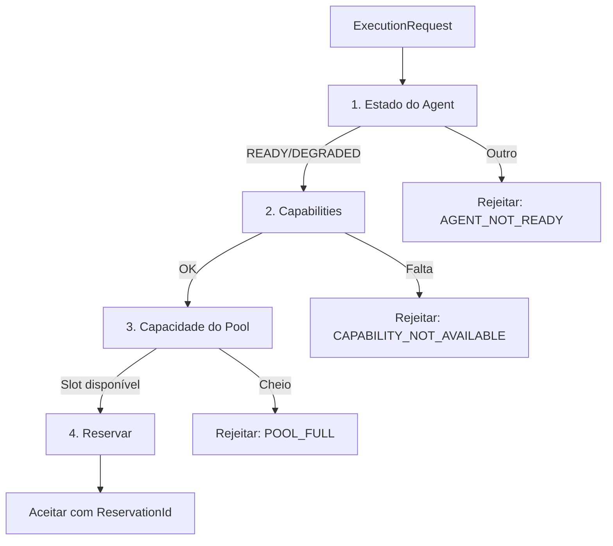

# Admission Controller

Decisão centralizada de aceitar ou rejeitar execuções.

## Avaliação em 4 etapas



## Motivos de Rejeição

| Código | Retryable | Descrição |
|--------|-----------|-----------|
| `POOL_FULL` | sim | Pool sem slots |
| `GLOBAL_LIMIT_REACHED` | sim | Limite global atingido |
| `INSUFFICIENT_MEMORY` | sim | Memória insuficiente |
| `INSUFFICIENT_DISK` | sim | Disco insuficiente |
| `CAPABILITY_NOT_AVAILABLE` | não | Capability ausente |
| `AGENT_NOT_READY` | sim | Agent não está pronto |
| `AGENT_DRAINING` | sim | Agent está encerrando |
| `INVALID_MANIFEST` | não | Manifesto inválido |

## Decisão

```json
{
  "accepted": true,
  "reservation_id": "res_abc123",
  "pool": "background",
  "slots_reserved": 1
}
```
