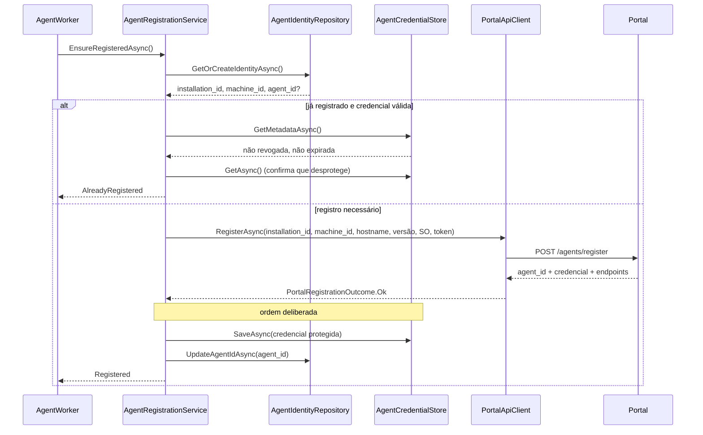

# Registro do Agent no Portal

## Fluxo



## Idempotência

`EnsureRegisteredAsync` roda em **toda** inicialização e não pode gerar um novo
registro quando já existe um válido. "Válido" exige as quatro condições:

1. `agent_id` persistido em `agent_identity`;
2. metadados de credencial presentes;
3. credencial não revogada e não expirada;
4. blob realmente desprotegível **nesta** máquina.

Falhando qualquer uma, o Agent registra de novo. O caso (4) cobre a situação real
de imagem de VM clonada ou perfil DPAPI recriado: o `agent_id` está lá, mas a
credencial não abre — insistir nela deixaria o Agent permanentemente incapaz de
autenticar.

## Ordem de gravação

A credencial é gravada **antes** do `agent_id`. Se o processo morrer no meio:

- credencial órfã, sem `agent_id` → próxima inicialização vê "não registrado" e registra de novo (seguro);
- se fosse ao contrário, teríamos `agent_id` sem credencial utilizável, e o Agent
  se consideraria registrado sem conseguir autenticar.

## Proteção da credencial

| Plataforma | Mecanismo | `IsHardened` |
|---|---|---|
| Windows | DPAPI, escopo LocalMachine + entropia da aplicação | true |
| Outras (dev/CI) | AES-256-GCM com chave em arquivo restrito | false |

O escopo **LocalMachine** é necessário porque o Agent roda como Windows Service
sob conta de sistema: escopo de usuário não sobreviveria à troca de conta.

Persistência em duas tabelas separadas:

- `agent_credentials_protected` — apenas o blob opaco;
- `agent_credentials_metadata` — tipo, fingerprint, datas, revogação. **Nunca o segredo.**

O fingerprint é SHA-256 truncado a 8 bytes (16 chars hex). Serve para correlacionar
logs sem expor o material.

## O que nunca aparece em log ou diagnóstico

- valor da credencial;
- `registration_token`;
- qualquer campo derivado que permita reconstruí-los.

O que **pode** aparecer: `installation_id`, `machine_id`, `agent_id`, fingerprint,
mecanismo de proteção, datas de expiração.

`AgentCredential.ToString()` é sobrescrito para emitir `value=***`, de forma que
uma interpolação acidental em log não vaze o segredo.

## Configuração

```json
{
  "Portal": {
    "Enabled": true,
    "ApiBaseUrl": "https://portal.example/api",
    "WebSocketUrl": "wss://portal.example/agents/connect",
    "RegistrationToken": "",
    "ConnectionTimeoutSeconds": 30,
    "HeartbeatIntervalSeconds": 15,
    "ReconnectMaximumSeconds": 120,
    "RegistrationTimeoutSeconds": 60,
    "CredentialRotationThresholdDays": 7,
    "RequireSecureTransport": true
  }
}
```

Prefira variável de ambiente ao token em arquivo:

```powershell
$env:AUTOMATION_AGENT_Portal__RegistrationToken = "token-de-uso-limitado"
```

`RequireSecureTransport` força HTTPS/WSS. Só desative em ambiente de teste local
controlado — a validação roda na inicialização e o serviço não sobe se violada.

## Classificação de falhas

| Situação | HTTP | Resultado | Retryable |
|---|---|---|---|
| Token inválido | 401 | `Rejected` | não |
| Agent revogado | 403 | `Rejected` | não |
| Token já usado | 409 | `Rejected` | não |
| Token expirado | 410 | `Rejected` | não |
| Versão não suportada | 426 | `Rejected` | não |
| Rate limit | 429 | `Failed` | sim |
| Erro do Portal | 5xx | `Failed` | sim |
| Timeout / rede | — | `Failed` | sim |

Falha no registro **não impede o Agent de subir**. Ele segue funcional localmente
e o health check `agent_registration` reporta `degraded`.

## Health check

| Situação | Estado |
|---|---|
| Portal desabilitado | `healthy` |
| Registrado, credencial válida, DPAPI | `healthy` |
| Não registrado, Portal habilitado | `degraded` |
| Proteção não reforçada (AES fallback) | `degraded` |
| Credencial perto de expirar | `degraded` |
| Credencial revogada | `unhealthy` |
| Credencial expirada | `unhealthy` |

## Comandos

```powershell
# Estado do registro (sem expor segredos)
AgentService.exe portal status

# Força novo registro, descartando a credencial atual
AgentService.exe portal register
```

## Testes

| Teste | Arquivo |
|---|---|
| `agent-registration` | `Registration/AgentRegistrationTests.Register_PersistsAgentIdAndCredential` |
| `registration-idempotent` | `Registration/AgentRegistrationTests.SecondStartup_DoesNotRegisterAgain` |
| `invalid-registration-token` | `Registration/AgentRegistrationTests.InvalidToken_IsRejectedWithoutPersistingAnything` |
| `credential-protection` | `Registration/CredentialStoreTests` + `Credentials/CredentialProtectorTests` |
