# Arquitetura do Automation Agent — Fase 1

## Visão Geral

```mermaid
flowchart TB
    subgraph Portal["Portal de Automações (control plane)"]
        API["API REST"]
        Gateway["Agent Gateway"]
    end

    subgraph Agent["Automation Agent (execution plane)"]
        Service["Agent.Service\n(host, lifecycle)"]
        App["Agent.Application\n(profiler, monitor, health)"]
        Domain["Agent.Domain\n(modelos, estados, contratos)"]
        Infra["Agent.Infrastructure\n(SQLite, diretórios, config)"]
        Protocol["Agent.Protocol\n(envelopes, relatórios)"]
        Win["Agent.Windows\n(OS, CPU, RAM, disco, sessão)"]
    end

    Service --> App
    App --> Domain
    App --> Infra
    App --> Protocol
    App --> Win
    Infra --> Domain
    Protocol --> Domain
    Win --> Domain

    Agent -.->|"futuro: WebSocket"| Gateway
```



## Projetos

| Projeto | Responsabilidade |
|---------|------------------|
| Agent.Domain | Modelos, enums, máquinas de estado, contratos (interfaces) |
| Agent.Infrastructure | SQLite, diretórios, configuração, relógio, persistência |
| Agent.Protocol | Envelopes de protocolo, relatório da máquina |
| Agent.Windows | Coleta de OS, CPU, memória, disco, sessão, software |
| Agent.Application | Machine Profiler, Resource Monitor, health checks, diagnóstico |
| Agent.Service | Worker Service host, inicialização, DI, Windows Service |

## Dependências

```
Agent.Service → Agent.Application → Agent.Infrastructure → Agent.Domain
                                  → Agent.Protocol      → Agent.Domain
                                  → Agent.Windows        → Agent.Domain
```

Não há dependências circulares. O Domain não depende de nenhum outro projeto.
