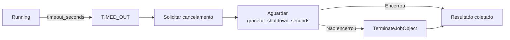
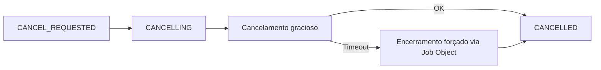

# Cancelamento e Timeout

## Timeout

## Cancelamento

## Implementação

O `CancellationManager` cria um `CancellationTokenSource` vinculado:
- Ao token do caller (shutdown do Agent)
- Com timeout configurado

O `ProcessTreeManager` executa:
1. Aguarda `gracefulTimeoutMs`
2. Se não encerrou: `TerminateJobObject` (toda a árvore)
3. Confirma encerramento com `WaitForExit(3000)`

## Registro

Cada cancelamento registra:
- Quem solicitou (agent, timeout, usuário)
- Quando foi solicitado
- Duração do cancelamento
- Se encerramento forçado foi necessário
