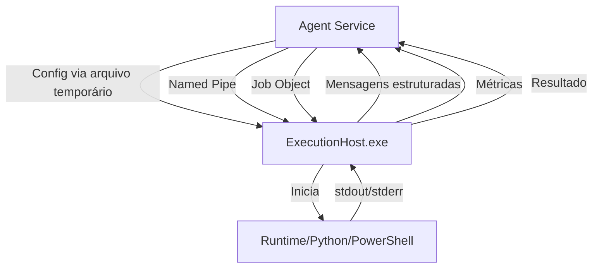

# Execution Host

O `ExecutionHost.exe` é um processo separado responsável por executar automações em isolamento total do Agent Service.

## Arquitetura



## Responsabilidades

O ExecutionHost:

1. Recebe configuração via arquivo temporário protegido (deletado após leitura)
2. Valida caminhos e configuração
3. Conecta ao Agent Service via Named Pipe
4. Inicia o runtime adequado (Python, PowerShell, executável)
5. Captura stdout e stderr em arquivos separados
6. Monitora métricas do processo (CPU, memória)
7. Envia heartbeats e logs via pipe
8. Produz resultado estruturado em `output/metrics.json`
9. Encerra com código de saída consistente

O ExecutionHost **não deve**:

- Acessar o SQLite principal do Agent
- Comunicar diretamente com o Portal
- Alterar o Runtime Store ou Package Store
- Iniciar outras execuções

## Protocolo de Comunicação

Mensagens via Named Pipe no formato JSON-line:

```json
{
  "protocol_version": "1.0",
  "message_id": "abc123",
  "message_type": "execution.log",
  "sent_at": "2026-07-28T15:00:00Z",
  "execution_id": "exec_456",
  "execution_attempt_id": "att_001",
  "sequence": 12,
  "payload": { "level": "info", "message": "Processing item 3/10" }
}
```

### Tipos de Mensagem

| Tipo | Direção | Descrição |
|------|---------|-----------|
| `execution_host.ready` | Host → Agent | ExecutionHost iniciado e pronto |
| `execution.started` | Host → Agent | Processo da automação iniciado |
| `execution.log` | Host → Agent | Linha de log (stdout/stderr) |
| `execution.progress` | Host → Agent | Progresso (current/total) |
| `execution.metric` | Host → Agent | Métrica de recurso |
| `execution.result` | Host → Agent | Resultado final |
| `execution.failed` | Host → Agent | Falha na execução |
| `execution.cancellation_requested` | Agent → Host | Solicitação de cancelamento |
| `execution.cancelled` | Host → Agent | Confirmação de cancelamento |
| `execution.heartbeat` | Host → Agent | Heartbeat periódico |

## Segurança

- Configuração via arquivo temporário (não linha de comando)
- Token aleatório por execução
- Secrets via variáveis de ambiente do processo (não visíveis externamente)
- Arquivo de config deletado após leitura
- Validação de caminhos contra path traversal
- Executáveis validados dentro do pacote/runtime

## Códigos de Saída

| Código | Significado |
|--------|-------------|
| 0 | Execução bem-sucedida |
| 1 | Falha na automação |
| 2 | Erro fatal no ExecutionHost |

## Publicação

```powershell
dotnet publish src\Agent.ExecutionHost -c Release -r win-x64 --self-contained
```
