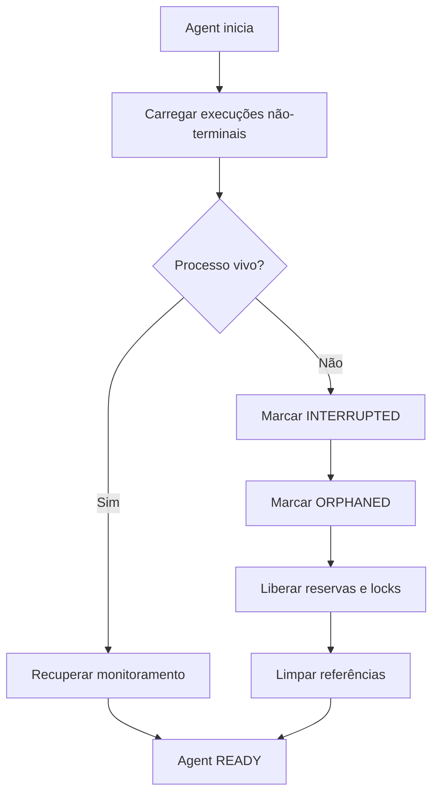

# Recuperação após Reinício

## Fluxo



## Cenários

### ExecutionHost ainda vivo
1. Validar PID
2. Verificar Job Object
3. Recuperar monitoramento
4. Marcar como recuperada

### ExecutionHost morto
1. Marcar como `INTERRUPTED` → `ORPHANED`
2. Liberar reserva de capacidade
3. Liberar locks exclusivos
4. Limpar arquivos temporários

### Máquina reiniciada
- Execuções anteriores marcadas como interrompidas
- Retomada exata depende de checkpoints (Fase futura)
- Reservas stale são expiradas automaticamente

## Implementação

O `AgentWorker` executa durante a inicialização:

```csharp
await _executionManager.RecoverOrphanedAsync(ct);
await _reservationManager.ExpireStaleAsync(ct);
```
