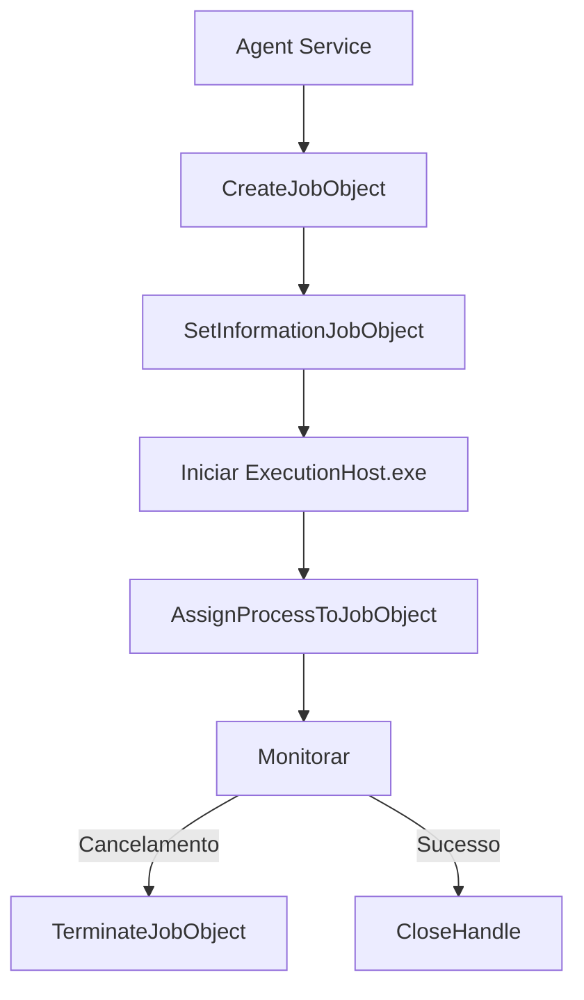

# Windows Job Objects

Isolamento de processos de automação via Windows Job Objects.

## Objetivo

Cada ExecutionHost e sua árvore de processos filhos são associados a um Job Object para:

- Rastrear processos filhos automaticamente
- Impedir processos órfãos
- Encerrar a árvore completa de processos
- Monitorar uso de recursos (memória peak)
- Aplicar limites de memória e processos

## Implementação



## API Win32 utilizada

| Função | Uso |
|--------|-----|
| `CreateJobObjectW` | Criar Job Object nomeado |
| `SetInformationJobObject` | Definir limites (memória, processos, KILL_ON_JOB_CLOSE) |
| `AssignProcessToJobObject` | Associar processo ao Job |
| `TerminateJobObject` | Encerrar todos os processos |
| `QueryInformationJobObject` | Consultar peak memory |
| `CloseHandle` | Liberar handle |

## Limites aplicados

- `JOB_OBJECT_LIMIT_KILL_ON_JOB_CLOSE` — Encerra processos se o Job Object for fechado
- `JOB_OBJECT_LIMIT_PROCESS_MEMORY` — Limite de memória por processo (se configurado)
- `JOB_OBJECT_LIMIT_ACTIVE_PROCESS` — Máximo de 50 processos por Job

## Fluxo de Cancelamento

```
Solicitar cancelamento gracioso (via pipe ou kill signal)
    ↓
Aguardar graceful_cancellation_seconds
    ↓
Se não encerrou: TerminateJobObject
    ↓
Confirmar encerramento de toda a árvore
```
