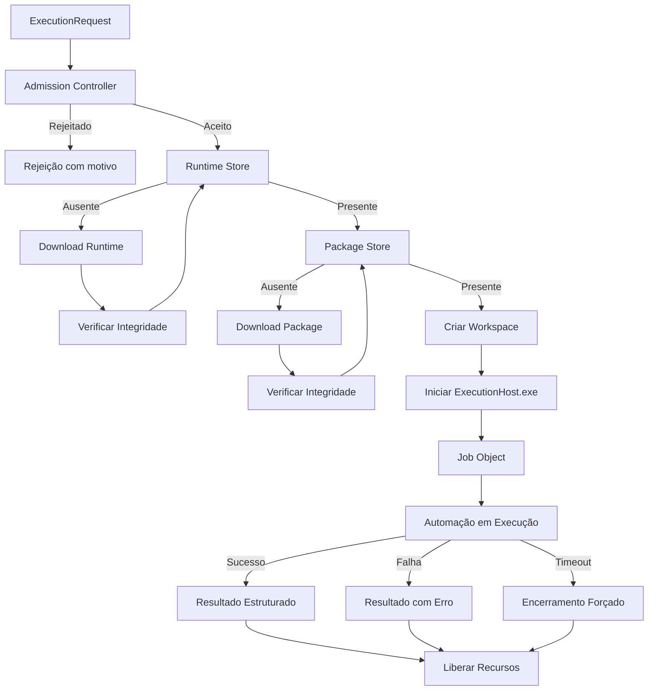
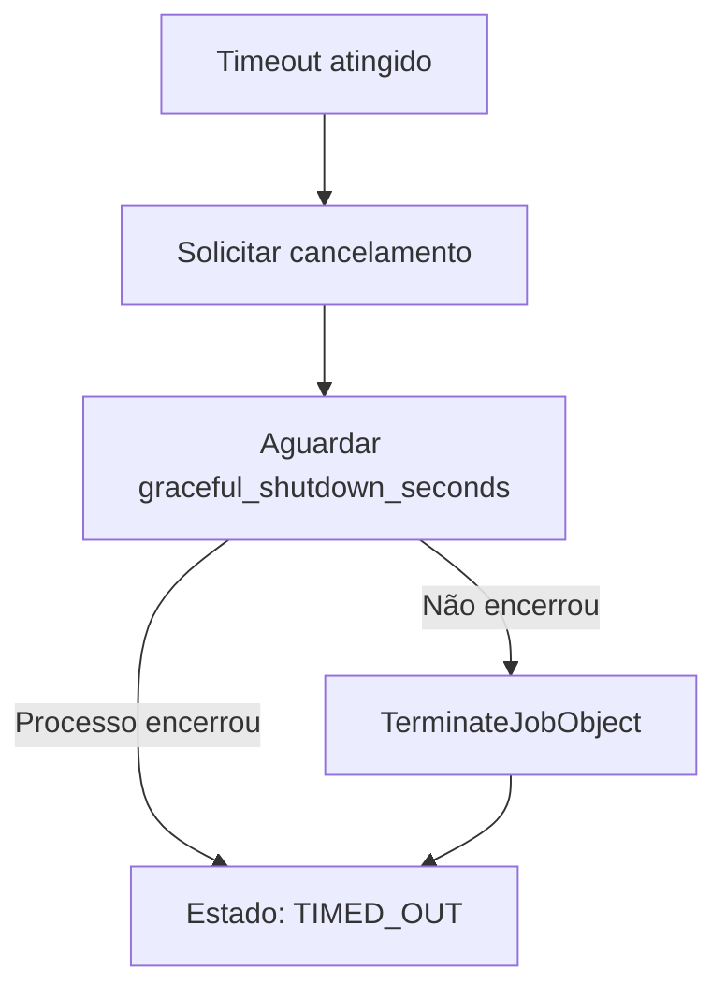

# Execução Local

Fluxo completo de execução de automações pelo Agent.

## Fluxo de Execução



## Admission Controller

Antes de iniciar qualquer execução, o Admission Controller verifica:

1. **Estado do Agent** — deve estar `READY` ou `DEGRADED`
2. **Capabilities** — a máquina suporta o que a automação precisa
3. **Capacidade** — há slots disponíveis no pool adequado
4. **Reserva** — recursos são reservados antes da preparação

### Motivos de Rejeição

- `POOL_FULL` — Todos os slots do pool estão ocupados
- `INSUFFICIENT_MEMORY` — Memória insuficiente
- `INSUFFICIENT_DISK` — Disco insuficiente
- `CAPABILITY_NOT_AVAILABLE` — Capability ausente
- `AGENT_NOT_READY` — Agent não está pronto

## Pools de Execução

| Pool | Uso | Padrão |
|------|-----|--------|
| `background` | Automações sem interface | 3 slots |
| `browser` | Playwright headless | 1 slot |
| `interactive` | Reservado para Fase 3 | 0 slots |

## Workspace

Cada tentativa cria um diretório exclusivo:

```
executions/
└── exec_456/
    └── att_001/
        ├── input/          ← Dados de entrada
        ├── workspace/      ← Diretório de trabalho
        ├── output/         ← Resultado e métricas
        ├── artifacts/      ← Artefatos gerados
        ├── logs/           ← stdout.log, stderr.log
        └── temp/           ← Arquivos temporários
```

## Cancelamento e Timeout



## CLI de Desenvolvimento

```powershell
# Listar execuções ativas
AgentService.exe execution list

# Consultar cache
AgentService.exe cache status

# Limpar cache
AgentService.exe cache cleanup
```

## Recuperação após Reinício

Ao iniciar, o Agent:

1. Identifica execuções em estado não-terminal
2. Verifica se o processo ainda está vivo (PID + Job Object)
3. Se vivo: recupera monitoramento
4. Se morto: marca como `INTERRUPTED` → `ORPHANED`
5. Libera reservas e locks abandonados
6. Expira reservas stale
