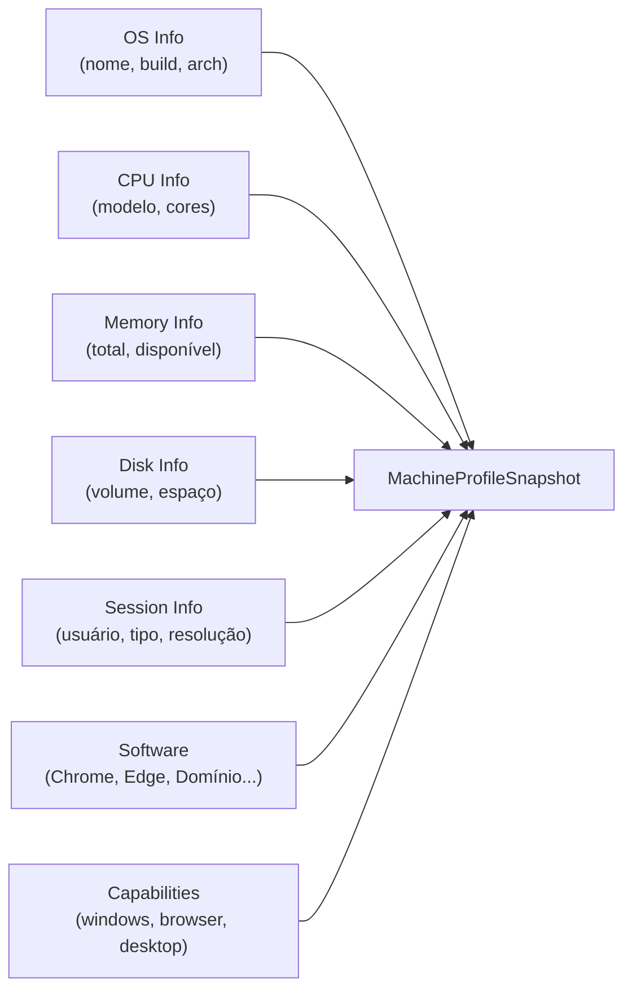

# Machine Profiler

Responde à pergunta: **Quais são as características desta máquina?**

## Coleta

## Software detectado

- Google Chrome
- Microsoft Edge
- Microsoft Excel / Office
- WebView2
- PowerShell
- Domínio Contábil

Detecção usa registro do Windows e caminhos conhecidos.
Nunca assume instalação apenas por existir uma pasta.
