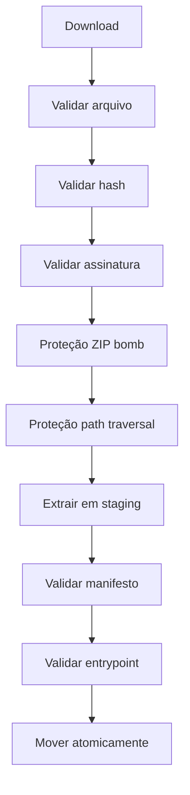

# Package Store

Armazenamento local imutável de pacotes de automação.

## Estrutura

```
store/
└── packages/
    └── portal.processar_documentos/
        └── 1.2.0/
            └── sha256_efgh5678/
                ├── automation.json
                ├── package/
                └── verification.json
```

## Conteúdo do Pacote

```
automation.json       ← Manifesto obrigatório
application/          ← Código da automação
schemas/              ← Schemas de input/output (opcional)
resources/            ← Recursos adicionais (opcional)
checksums.json        ← Checksums internos (opcional)
```

## Fluxo



## Regras

- Pacotes publicados são imutáveis
- Mesma versão = mesmo conteúdo (rejeita divergência)
- Versões diferentes coexistem
- Pacotes em uso não podem ser removidos
- Pacote inválido nunca chega ao ExecutionHost
- Evicção LRU quando o cache excede o limite
