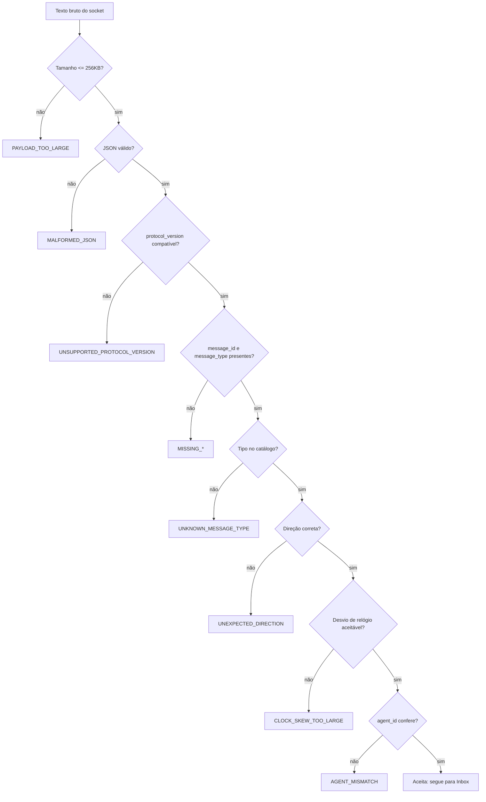

# Protocolo Portal ↔ Agent — v1.0

## Envelope

Toda mensagem, em qualquer direção, usa o mesmo envelope versionado.
Campos que não se aplicam a um tipo são **omitidos** da serialização.

```json
{
  "protocol_version": "1.0",
  "message_id": "msg_a1b2c3",
  "message_type": "execution.progress",
  "sent_at": "2026-07-31T18:00:00Z",
  "agent_id": "agt_123",
  "installation_id": "ins_456",
  "execution_id": "exec_789",
  "execution_attempt_id": "att_001",
  "sequence": 42,
  "correlation_id": "corr_123",
  "payload": {}
}
```

| Campo | Obrigatório | Observação |
|---|---|---|
| `protocol_version` | sim | Rejeição explícita se o major divergir |
| `message_id` | sim | Globalmente único; base da deduplicação |
| `message_type` | sim | Precisa estar no catálogo fechado |
| `sent_at` | sim | UTC; tolerância de 10 min de desvio de relógio |
| `agent_id` | após registro | Mensagens para outro agent são rejeitadas |
| `sequence` | eventos de execução | Monotônica por `execution_attempt_id` |

Implementação: `Agent.Protocol/Envelope/ProtocolEnvelope.cs`.

## Compatibilidade de versão

A compatibilidade é por **major version**:

- Agent 1.0 aceita `1.0`, `1.7`, `1.99`.
- Agent 1.0 **rejeita** `2.0` com `protocol.error` / `UNSUPPORTED_PROTOCOL_VERSION`.

Isso permite ao Portal adicionar campos opcionais sem quebrar Agents antigos,
mas força upgrade explícito em mudanças incompatíveis.

## Limites

| Limite | Valor | Motivo |
|---|---|---|
| Tamanho de mensagem | 256 KB | Artefatos grandes vão por HTTPS, nunca pelo socket |
| Mensagens por lote | 500 | Evita bloquear o socket em replay de Outbox |
| Desvio de relógio | 10 min | Detecta máquina com hora errada |

Uma mensagem de saída acima do limite **não é enviada**: `EnvelopeValidator.TrySerializeOutbound`
falha e orienta o uso do canal HTTPS.

## Validação de entrada

Nenhuma mensagem chega ao Command Dispatcher sem passar por `EnvelopeValidator.ParseInbound`.
A ordem das checagens é deliberada — as mais baratas primeiro:



Todo erro é persistido em `protocol_errors` e devolvido ao Portal como `protocol.error`.

## Direção das mensagens

O catálogo separa o que cada lado pode enviar. Uma `execution.accept` vinda do
Portal é rejeitada com `UNEXPECTED_DIRECTION` — só o Agent emite aceite.

### Do Portal para o Agent

```
agent.registered, agent.registration_failed, agent.heartbeat_ack
execution.offer, execution.commit, execution.commit_rejected, execution.cancel_requested
execution.lease_granted, execution.lease_renewed, execution.lease_expired
agent.sync_request, message.ack, command.ack, protocol.error
```

### Do Agent para o Portal

```
agent.register, agent.heartbeat, agent.profile, agent.capacity, agent.state_changed
agent.health, agent.diagnostics_summary, agent.draining, agent.ready
execution.accept, execution.reject, execution.preparing, execution.started
execution.progress, execution.log, execution.metric, execution.artifact_created
execution.completed, execution.failed, execution.cancelling, execution.cancelled
execution.timed_out, execution.interrupted
execution.lease_renew, execution.lease_lost
agent.sync_state, message.ack, command.ack, protocol.error
```

### Comandos

Subconjunto do inbound que dispara ação local e por isso **exige persistência na
Inbox antes do processamento**:

```
execution.offer, execution.commit, execution.cancel_requested, agent.sync_request
```

## Ordenação de eventos

A ordem final é dada por `execution_attempt_id` + `sequence`, nunca por `sent_at`.
Relógios de processos diferentes (Execution Host, Session Runner, Agent Service)
não são confiáveis para ordenação.

## Códigos de erro

| Código | Significado |
|---|---|
| `MALFORMED_JSON` | Corpo não é JSON válido |
| `MISSING_PROTOCOL_VERSION` | Campo ausente |
| `UNSUPPORTED_PROTOCOL_VERSION` | Major incompatível |
| `MISSING_MESSAGE_ID` | Sem identificador para deduplicar |
| `MISSING_MESSAGE_TYPE` | Sem tipo |
| `UNKNOWN_MESSAGE_TYPE` | Tipo fora do catálogo |
| `UNEXPECTED_DIRECTION` | Tipo válido, direção errada |
| `MISSING_SENT_AT` | Sem timestamp |
| `CLOCK_SKEW_TOO_LARGE` | Relógio divergente demais |
| `PAYLOAD_TOO_LARGE` | Acima de 256 KB |
| `INVALID_PAYLOAD` | Payload não corresponde ao tipo |
| `AGENT_MISMATCH` | Endereçada a outro `agent_id` |

## Arquivos

```
Agent.Protocol/
├── Envelope/ProtocolEnvelope.cs      envelope e fábrica
├── Envelope/ProtocolConstants.cs     versão e limites
├── Messages/PortalMessageTypes.cs    catálogo fechado + direções
├── Serialization/ProtocolJson.cs     opções de JSON compartilhadas
├── Validation/EnvelopeValidator.cs   porta de entrada
└── Registration/RegistrationContracts.cs
```
