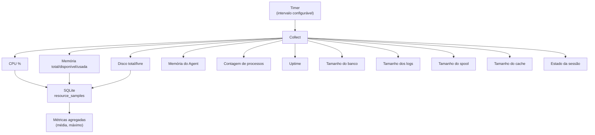

# Resource Monitor

Responde à pergunta: **Como a máquina está neste momento?**

## Métricas coletadas



## Configuração

```json
{
  "Monitoring": {
    "SampleIntervalSeconds": 5,
    "HistoryRetentionMinutes": 60
  }
}
```
