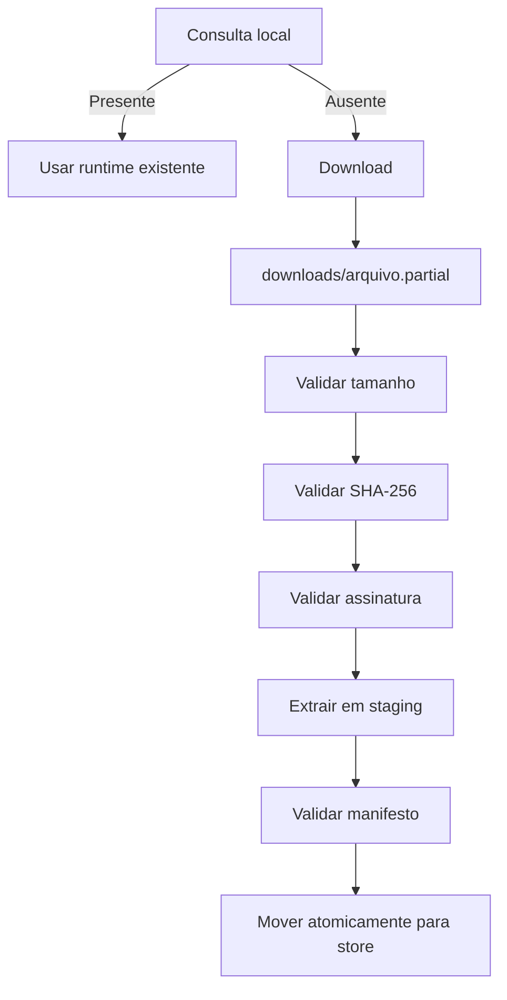

# Runtime Store

Armazenamento local imutável de runtimes.

## Estrutura

```
store/
└── runtimes/
    └── python-core/
        └── 3.13/
            └── sha256_abcd1234/
                ├── runtime.json
                ├── content/
                └── verification.json
```

## Fluxo de Importação



## Requisitos

- Download retomável com retry e backoff
- Instalação atômica (staging → store)
- Múltiplas versões coexistentes
- Deduplicação por hash
- Proteção de runtime em uso (não pode ser removido)
- Limpeza de downloads incompletos
- Runtime imutável após validação
