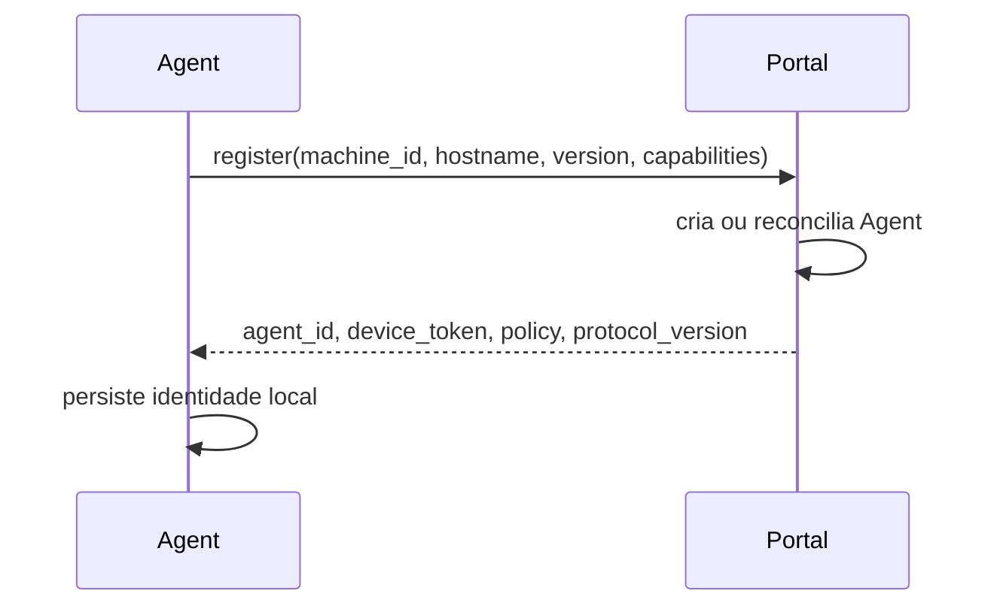
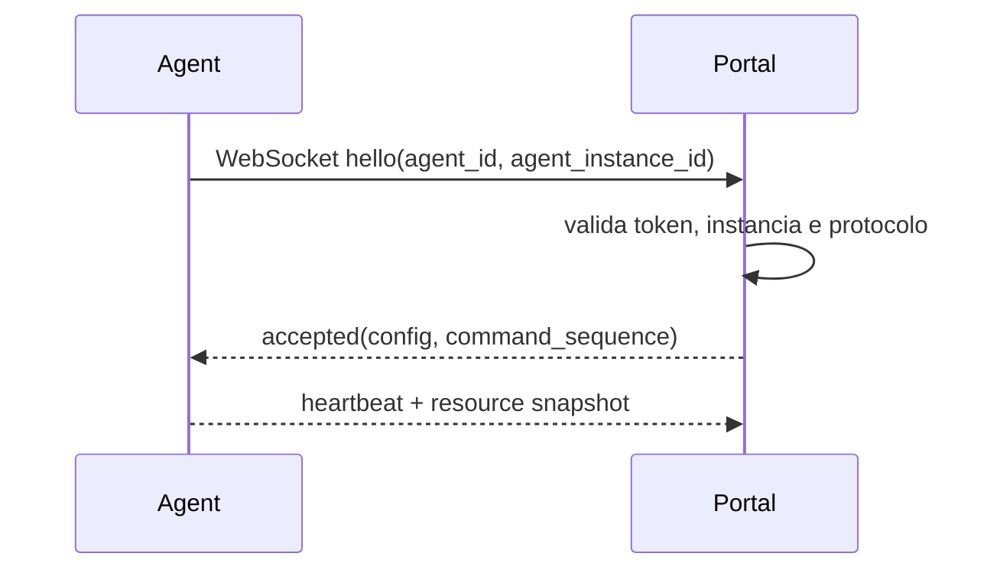
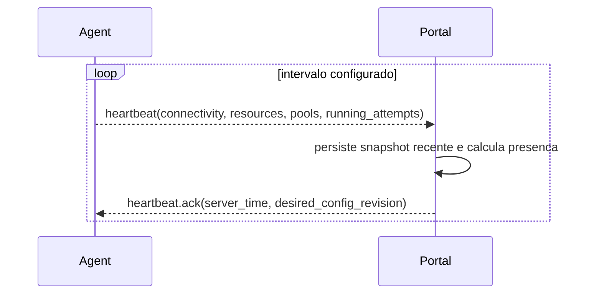

# Ciclo de Vida do Agent

Status: vigente.

## Registro

## Conexao

Cada Agent mantem uma unica conexao WebSocket ativa com o Portal. Nao crie
WebSocket por automacao ou execucao.

## Heartbeat

Heartbeat nao sobrescreve politica administrativa. Snapshots possuem
`observed_at`, `agent_instance_id`, `revision` e `ttl`.

## Estados por dimensao

Conectividade:

- `connecting`
- `online`
- `stale`
- `disconnected`
- `offline`

Administrativo:

- `pending_registration`
- `enabled`
- `draining`
- `maintenance`
- `updating`
- `disabled`

Saude:

- `healthy`
- `degraded`
- `error`

Ocupacao calculada:

- `idle`
- `busy`
- `saturated`

## Responsabilidades do Agent

- Identidade local e `AgentInstance`.
- Descoberta de capabilities.
- Analise de CPU, memoria, disco, sessao e softwares.
- Calculo de capacidade recomendada.
- Aplicacao da politica recebida.
- Validacao final da oferta.
- Reserva local, preparacao de runtime/pacote, isolamento e execucao.
- Monitoramento, cancelamento e encerramento da arvore de processos.
- Eventos estruturados, spool offline, upload de artefatos e recuperacao local.

O Agent nao escolhe automacoes por conta propria, nao cria execucoes oficiais,
nao publica pacotes, nao controla fluxos, nao mantem estado global e nao inicia
uma oferta apenas porque a aceitou.

