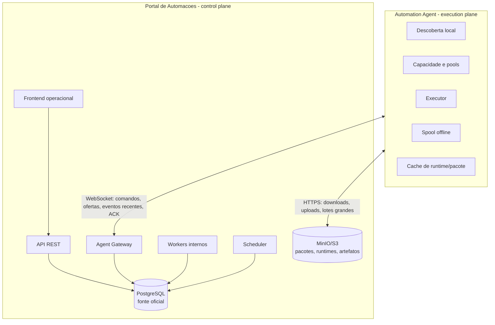
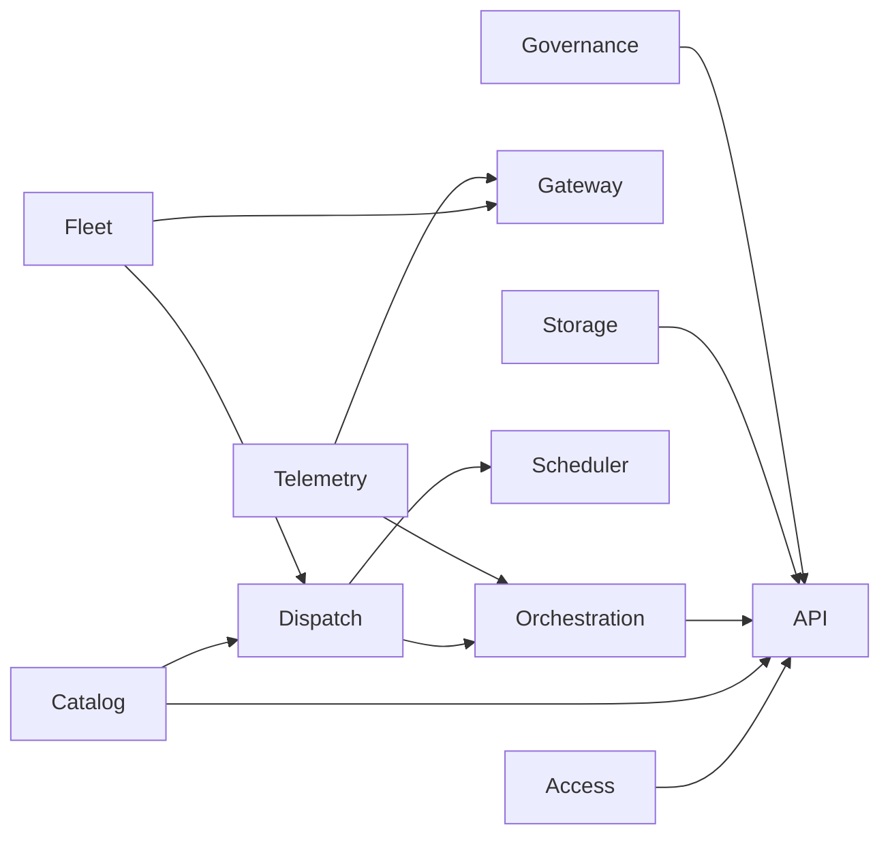
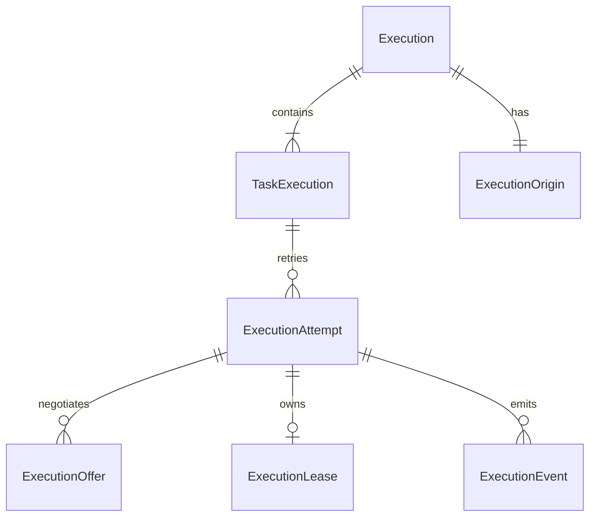
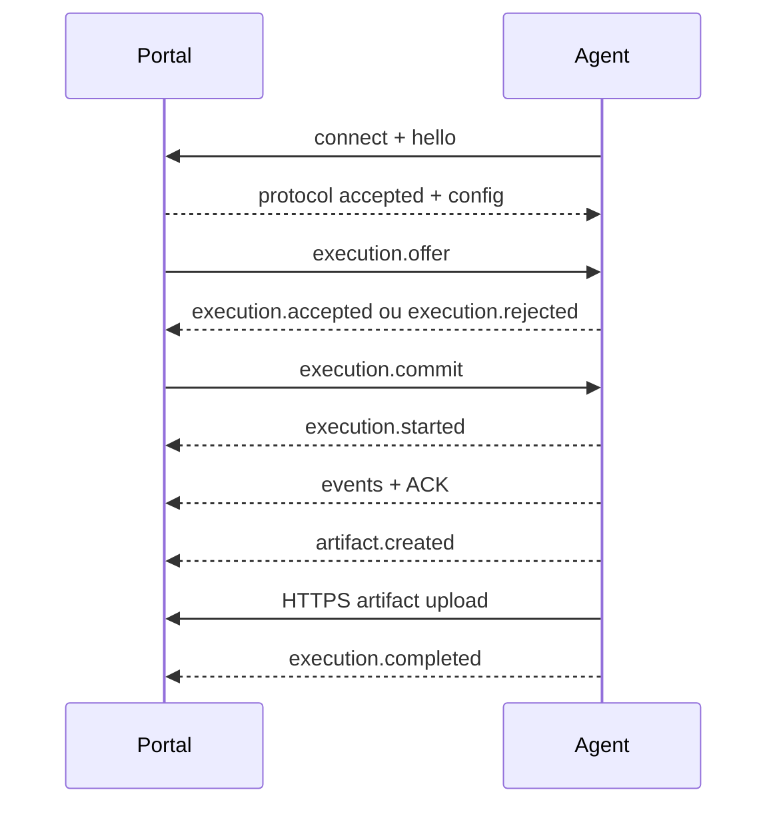

# Arquitetura Oficial

Status: vigente.

Este documento substitui a arquitetura anterior baseada em `Worker -> Job ->
Execution` como modelo conceitual principal. O codigo atual ainda preserva
nomes legados por compatibilidade, mas novas implementacoes devem seguir os
contextos e contratos abaixo.

## Visao

O sistema tem dois planos:

- Portal de Automacoes: control plane.
- Automation Agent: execution plane.



Regras:

- O Portal decide o que precisa ser executado.
- O Portal seleciona Agents candidatos.
- O Agent faz a validacao final de admissao e pode rejeitar uma oferta.
- O Portal e a fonte oficial dos estados persistentes.
- O Agent e a fonte das observacoes locais da maquina e da execucao.
- WebSocket, Redis, Celery e mensageria nao sao fontes de verdade.

## Stack encontrada

- Backend: FastAPI, SQLAlchemy 2, Alembic, PostgreSQL, Redis, Celery, JWT.
- Frontend: Next.js 15, React, TypeScript, Tailwind CSS.
- Infra: Docker Compose, Nginx, Redis, PostgreSQL, Flower, MinIO/S3 ou storage local.
- Agent atual: protocolo exposto pelo Portal em `agents.py` e
  `agent_gateway_service.py`; o repo externo do Agent nao esta presente neste
  workspace.

## Monolito modular

O Portal deve permanecer um monolito modular. Pontos de entrada como API,
Gateway, Workers e Scheduler podem rodar em processos diferentes, mas
pertencem ao mesmo sistema, repositorio e conjunto de modulos.



Estrutura-alvo:

```text
backend/
  modules/
    access/
    catalog/
    fleet/
    orchestration/
    dispatch/
    telemetry/
    storage/
    governance/
  api/
  gateway/
  workers/
  infrastructure/
  shared/
```

Cada modulo deve conter, quando aplicavel:

```text
domain/
application/
infrastructure/
api/
tests/
```

## Contextos oficiais

- Access: usuarios, organizacoes, equipes, auth, sessoes, papeis, permissoes.
- Catalog: automacoes, versoes, manifests, schemas, pacotes, runtimes,
  publicacao, compatibilidade.
- Fleet: Agents, AgentInstances, capabilities, machine profiles, recursos,
  sessoes, pools, diagnosticos, atualizacoes, estado administrativo.
- Orchestration: Execution, TaskExecution, ExecutionAttempt, fluxos,
  agendamentos, retries, timeout, cancelamento e resultados.
- Dispatch: filas, selecao, ofertas, reservas, commits, locks, leases,
  rejeicoes e redistribuicao.
- Telemetry: eventos, logs, metricas, sequencias, deduplicacao, ACK, gaps,
  timeline e tempo real.
- Storage: artefatos, pacotes, runtimes, uploads, downloads, URLs temporarias,
  retencao e diagnosticos.
- Governance: segredos, auditoria, politicas, limites, seguranca e retencao.

## Ownership de dados

- Catalog: Automation, AutomationVersion, AutomationPackage, Runtime,
  RuntimeVersion.
- Fleet: Agent, AgentInstance, AgentCapability, AgentResourceSnapshot,
  AgentConfiguration.
- Orchestration: Execution, TaskExecution, ExecutionAttempt, FlowExecution,
  ScheduleExecution.
- Dispatch: ExecutionOffer, ResourceReservation, ResourceLock, ExecutionLease.
- Telemetry: ExecutionEvent, ExecutionLog, ExecutionMetric,
  EventAcknowledgement.
- Storage: Artifact, UploadSession, StoredObject.

Um modulo nao altera diretamente entidade pertencente a outro modulo. Use casos
de uso, comandos internos ou eventos internos. Controllers e handlers
WebSocket nao contem regras de dominio nem transicoes diretas de estado.

## Modelo de execucao



- Execution representa a solicitacao completa (`automation` ou `flow`).
- TaskExecution representa uma tarefa logica.
- ExecutionAttempt representa uma tentativa fisica em uma maquina.
- ExecutionOffer representa a oferta enviada a um Agent.
- Rejeicao de oferta nao e falha da automacao.
- Tentativas anteriores nunca sao sobrescritas.

## Estados do Agent

Nao use um unico campo para conectividade, saude, administracao e ocupacao.

- Conectividade: `connecting`, `online`, `stale`, `disconnected`, `offline`.
- Administrativo: `pending_registration`, `enabled`, `draining`,
  `maintenance`, `updating`, `disabled`.
- Saude: `healthy`, `degraded`, `error`.
- Ocupacao calculada: `idle`, `busy`, `saturated`.

`busy` nao substitui conectividade. Ocupacao e calculada a partir de pools,
execucoes, reservas e locks.

## Comunicacao Portal-Agent



WebSocket: handshake, heartbeat, ofertas, aceite, rejeicao, commit,
cancelamento, comandos administrativos, eventos recentes, ACK e renovacao de
lease.

HTTPS/S3/MinIO: downloads de runtimes e pacotes, uploads de artefatos e
diagnosticos, sincronizacao de lotes grandes e recuperacao apos longos
periodos offline.

## Armazenamento

PostgreSQL e a fonte oficial para catalogo, fleet, execucoes, tentativas,
ofertas, comandos, leases, eventos, outbox e inbox.

MinIO/S3 guarda pacotes, runtimes, artefatos e diagnosticos. Binarios grandes
nao devem ser armazenados no PostgreSQL.

Redis pode ser usado como cache, pub/sub, presenca acelerada ou rate limiting,
mas nunca como fonte oficial. RabbitMQ ou outro broker so deve ser introduzido
com necessidade comprovada.

## Fluxos

Fluxos comecam como DAGs confiaveis: sequencia, paralelismo, dependencias,
condicoes simples, input/output mapping, retry, timeout, cancelamento, skip e
continuar apos falha. Editor visual complexo fica fora da primeira entrega.

## Decisoes relacionadas

Veja `docs/adrs/` para as decisoes formais e `docs/migration.md` para a
evolucao segura dos modelos legados.

Documentos complementares:

- `docs/modules.md`
- `docs/state-machines.md`
- `contracts/`
