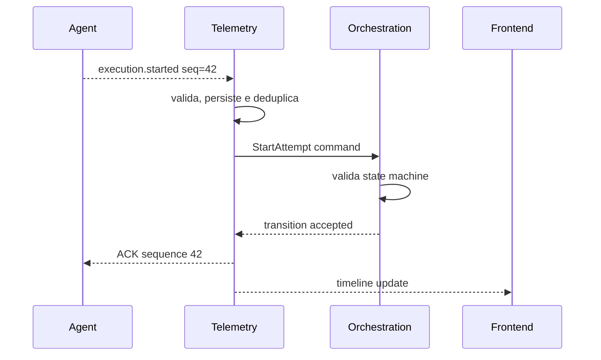

# Eventos

Status: vigente.

Eventos do Agent possuem entrega pelo menos uma vez, portanto podem ser
repetidos. O Portal deve persistir, deduplicar, detectar lacunas, confirmar
sequencias continuas e atualizar estados de forma idempotente.

Indice obrigatorio:

```text
UNIQUE(execution_attempt_id, event_sequence)
```

## Fluxo



## Tipos iniciais

- `execution.started`
- `execution.completed`
- `execution.failed`
- `execution.cancelled`
- `execution.timed_out`
- `task.started`
- `task.progress`
- `task.completed`
- `task.failed`
- `log`
- `warning`
- `error`
- `metric`
- `process.started`
- `process.exited`
- `artifact.created`
- `artifact.available`
- `artifact.failed`
- `diagnostic`

Logs nao sao apenas texto livre: devem conter nivel, timestamp, origem,
sequencia e payload estruturado quando aplicavel.

