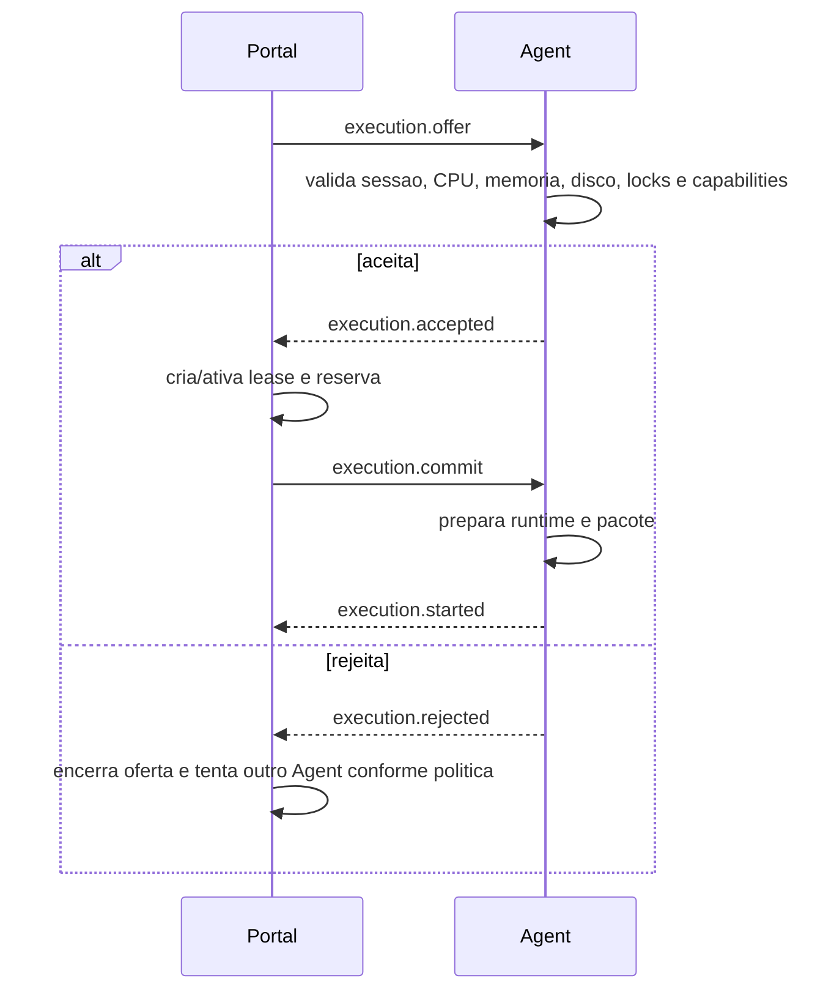
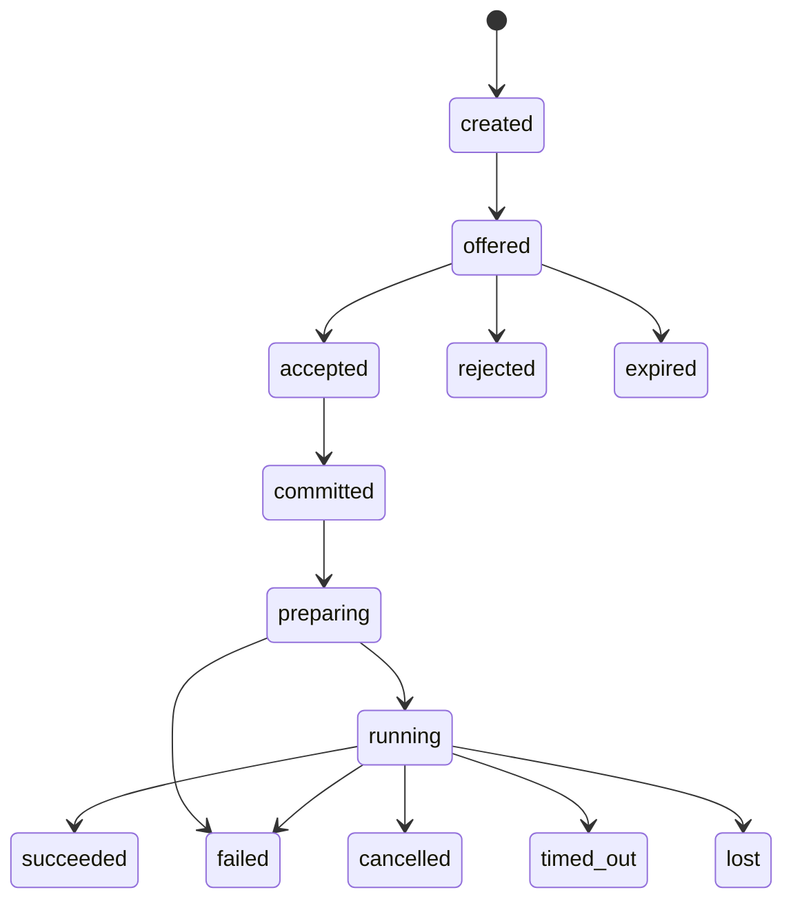
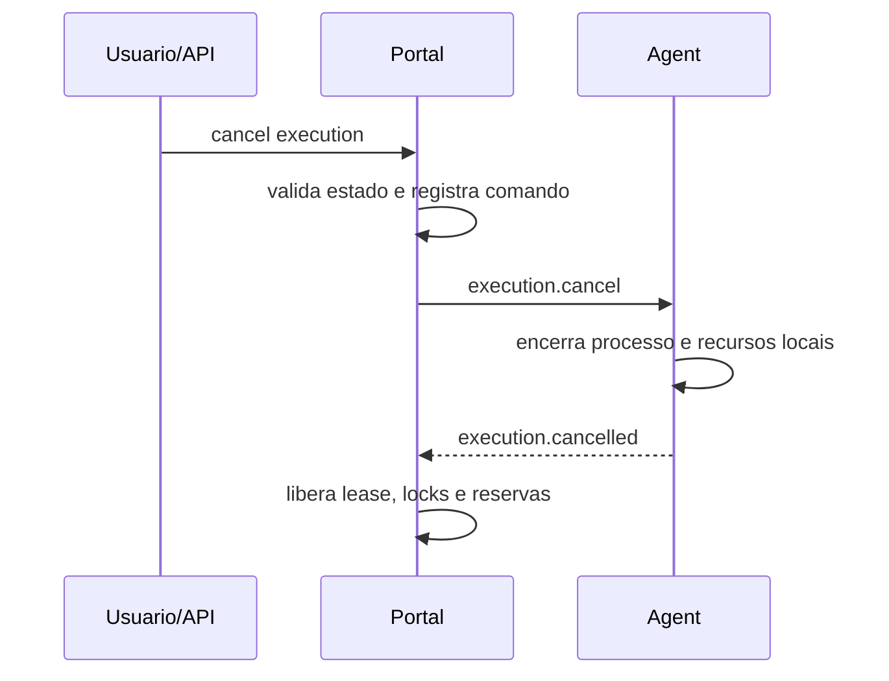
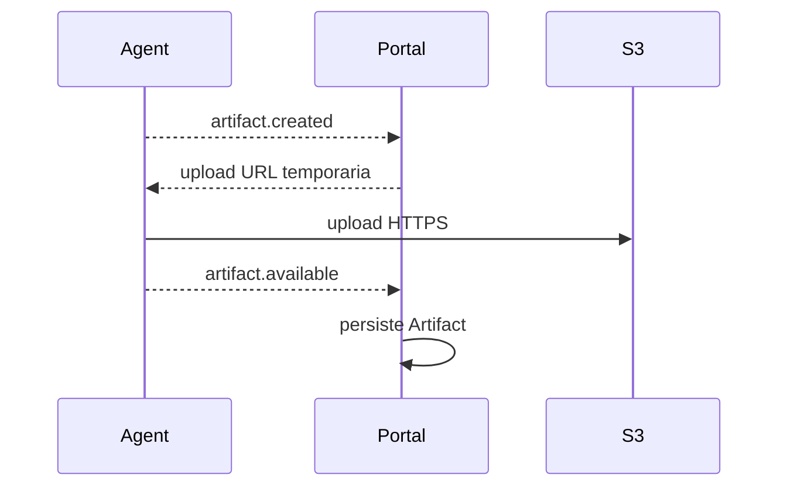

# Ciclo de Vida de Execucao

Status: vigente.

## Oferta, aceite e commit

## Transicoes

Regras:

- `accepted` nao significa `running`.
- O Agent nao inicia antes de receber `execution.commit`.
- Rejeicao de oferta nao falha a automacao.
- Retry cria nova `ExecutionAttempt`.
- Estado persistente muda por caso de uso de Orchestration/Dispatch.

## Cancelamento

## Upload de artefatos

