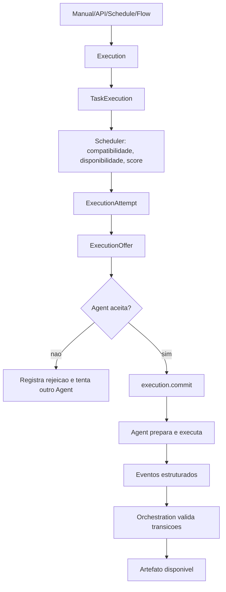
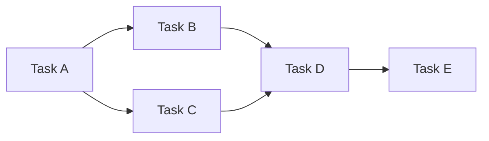

# Fluxos do Sistema

Status: superseded para arquitetura, preservado como compatibilidade historica.

O fluxo antigo `Webhook -> Dispatcher -> Worker -> Celery -> WebSocket` nao e
mais a arquitetura oficial para novas implementacoes. Ele descreve partes do
comportamento legado ainda presentes no codigo e deve ser consultado apenas
durante a migracao.

Use estes documentos como fonte oficial:

- `docs/architecture.md`
- `docs/domain-model.md`
- `docs/execution-lifecycle.md`
- `docs/protocol.md`
- `docs/scheduler.md`
- `docs/reliability.md`
- `docs/migration.md`

## Fluxo oficial de execucao

## Fluxo DAG

Fluxos devem comecar como DAGs confiaveis. Editor visual complexo e loops
recursivos ficam fora do primeiro marco funcional.
