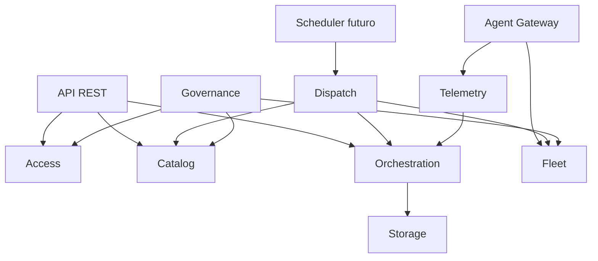

# Modulos do Portal

Status: vigente.

Este documento define as fronteiras logicas do monolito modular. A estrutura
fisica oficial vive em `backend/modules/`; `backend/app` foi removido no corte
final da migracao.

## Mapa de contextos

## Access

Responsavel por usuarios, organizacoes, equipes, autenticacao, sessoes,
papeis, permissoes e autorizacao.

Codigo legado removido relacionado:

- `backend/app/models/user.py`
- `backend/app/models/role.py`
- `backend/app/models/user_category_permission.py`
- `backend/app/services/auth_service.py`
- `backend/app/services/permission_service.py`
- `backend/app/api/v1/endpoints/auth.py`
- `backend/app/api/v1/endpoints/users.py`
- `backend/app/api/v1/endpoints/roles.py`

## Catalog

Responsavel por automacoes, versoes, manifests, schemas, pacotes, runtimes,
publicacao, bloqueio, descontinuacao e compatibilidade.

Codigo legado removido relacionado:

- `backend/app/models/automation.py`
- `backend/app/models/automation_version.py`
- `backend/app/models/automation_source.py`
- `backend/app/domain/automation_manifest.py`
- `backend/app/domain/automation_package.py`
- `backend/app/services/automation_service.py`
- `backend/app/services/automation_import_service.py`
- `backend/app/services/automation_version_lifecycle_service.py`

## Fleet

Responsavel por Agents, AgentInstances, registro, capabilities, perfil da
maquina, capacidade, sessao interativa, pools, diagnosticos, atualizacoes e
politicas administrativas do Agent.

Codigo legado removido relacionado:

- `backend/app/models/worker.py`
- `backend/app/services/worker_service.py`
- `backend/app/services/agent_gateway_service.py`
- `backend/app/api/v1/endpoints/workers.py`
- `backend/app/api/v1/endpoints/agents.py`

## Orchestration

Responsavel por execucoes, tarefas, tentativas, retries, timeout,
cancelamento, fluxos, agendamentos, dependencias e resultados.

Codigo legado removido relacionado:

- `backend/app/models/job.py`
- `backend/app/models/execution.py`
- `backend/app/models/schedule.py`
- `backend/app/models/trigger.py`
- `backend/app/services/execution_service.py`
- `backend/app/services/schedule_service.py`
- `backend/app/tasks/schedule_tasks.py`

## Dispatch

Responsavel por fila de distribuicao, Scheduler, selecao de Agents, ofertas,
reservas, commits, locks, leases, rejeicoes e redistribuicao.

Codigo legado removido relacionado:

- `backend/app/services/job_dispatcher_service.py`
- `backend/app/services/worker_preference_service.py`
- `backend/app/models/automation_worker_preference.py`

## Telemetry

Responsavel por eventos, logs, progresso, metricas, sequencias, deduplicacao,
ACK, deteccao de lacunas, timeline e realtime.

Codigo legado removido relacionado:

- `backend/app/models/log.py`
- `backend/app/services/realtime_service.py`
- `backend/app/services/websocket_broadcaster.py`
- `backend/app/api/v1/endpoints/realtime.py`

## Storage

Responsavel por artefatos, uploads, downloads, URLs temporarias, objetos
armazenados, retencao, binarios de pacotes, runtimes e diagnosticos.

Codigo legado removido relacionado:

- `backend/app/integrations/storage/`
- `backend/app/services/manual_upload_service.py`
- `backend/app/services/automation_package_resolver.py`

## Governance

Responsavel por segredos, auditoria, politicas, administracao, limites,
seguranca e retencao administrativa.

Codigo legado removido relacionado:

- `backend/app/models/audit.py`
- `backend/app/services/audit_service.py`
- `backend/app/api/v1/endpoints/audit.py`
- `backend/app/core/security.py`
- `backend/app/core/permissions.py`

## Dependencias permitidas

- API chama casos de uso de application.
- Gateway traduz protocolo e chama Fleet, Dispatch ou Telemetry.
- Telemetry persiste eventos e solicita transicoes a Orchestration.
- Dispatch consulta Catalog/Fleet por portas de leitura e cria ofertas/leases.
- Storage entrega referencias/URLs; nao decide estado de execucao.
- Governance aplica politicas por portas explicitas.

## Dependencias proibidas

- Controller alterar status diretamente.
- Handler WebSocket conter regra de Scheduler.
- Telemetry alterar tabela de Orchestration diretamente.
- Fleet alterar AutomationVersion.
- Catalog consultar estado local de Agent.
- Frontend acessar banco.
- Dominio depender de FastAPI, SQLAlchemy ou Celery.
- Redis, Celery, WebSocket ou SSE serem fonte oficial de estado.
