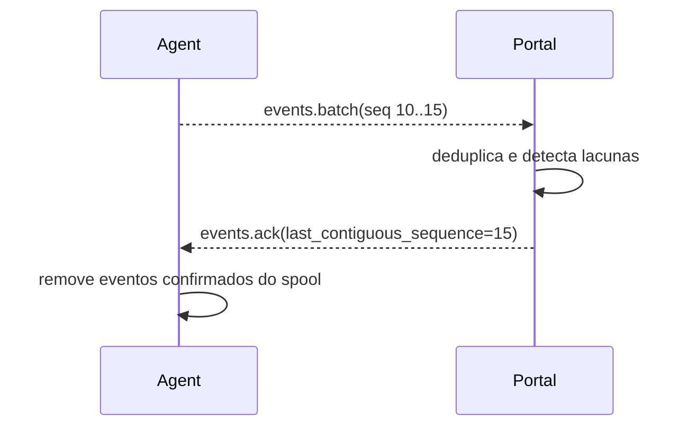
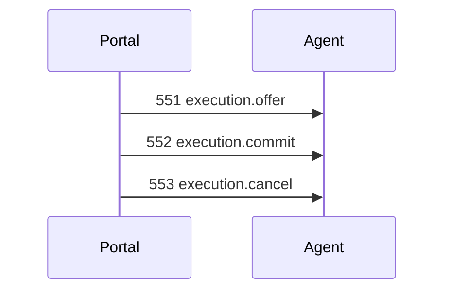
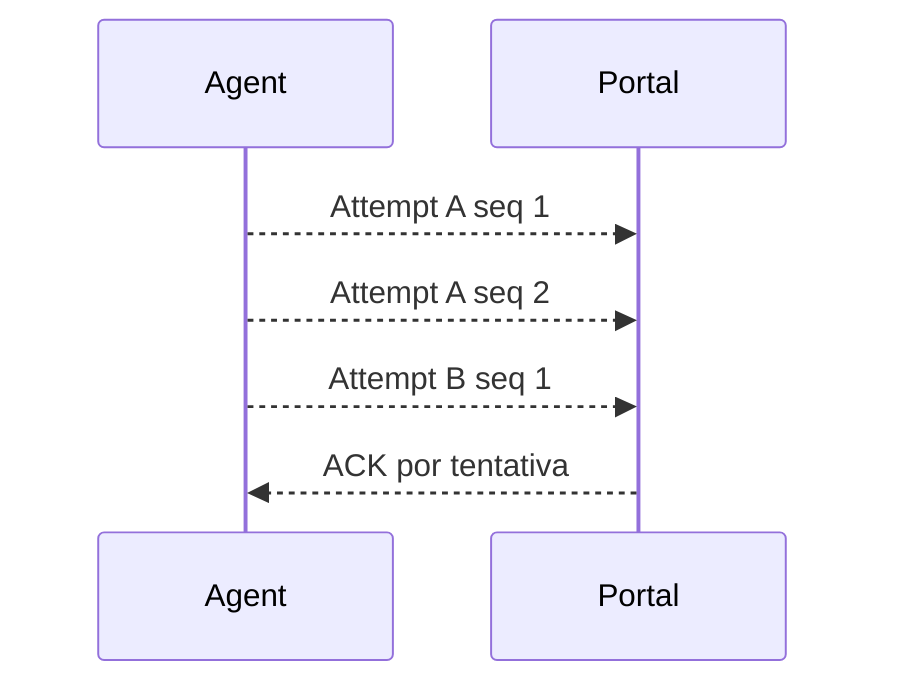
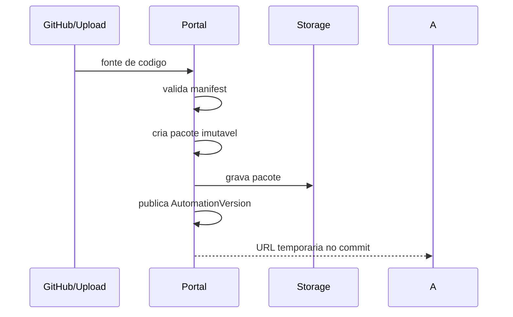

# Protocolo Portal-Agent

Status: vigente para contratos v1.

Os contratos versionados ficam em `contracts/`. Este documento explica o fluxo
e as regras de compatibilidade.

## Envelope

Toda mensagem Portal-Agent deve usar envelope versionado:

```json
{
  "protocol_version": "1.0",
  "message_id": "msg_01J...",
  "message_type": "execution.offer",
  "sent_at": "2026-07-27T10:00:00Z",
  "agent_id": "agt_123",
  "agent_instance_id": "agi_456",
  "payload": {}
}
```

Regras:

- `message_id` e obrigatorio.
- Mensagens recebidas do Agent sao deduplicadas por `message_id`.
- Eventos usam entrega pelo menos uma vez.
- Quebra incompatibile exige nova versao de protocolo.
- `agent_id` e `agent_instance_id` sao obrigatorios em mensagens Portal-Agent.

## Tipos iniciais

Portal para Agent:

- `execution.offer`
- `execution.commit`
- `execution.cancel`
- `agent.config.update`
- `lease.renew.request`
- `events.resend.request`

Agent para Portal:

- `agent.hello`
- `agent.heartbeat`
- `execution.accepted`
- `execution.rejected`
- `execution.started`
- `events.batch`
- `artifact.created`
- `artifact.available`
- `lease.renewed`

## ACK



## Compatibilidade

Versoes da etapa atual:

```json
{
  "agent_protocol_versions": ["1.0"],
  "portal_protocol_versions": ["1.0"],
  "selected_protocol_version": "1.0"
}
```

Nao presuma que todos os Agents serao atualizados simultaneamente. Agents
legados que usam `execution.assign` devem ser suportados apenas por adaptador
explicitamente marcado.

## Sequencias independentes

Command sequence identifica comandos do Portal para um Agent:

```text
agent_id + command_sequence
```



Event sequence identifica eventos produzidos por uma tentativa:

```text
execution_attempt_id + event_sequence
```



O acknowledgement informa a maior sequencia continua confirmada por tentativa.
Nao use uma unica sequencia para comandos e eventos.

## Publicacao de pacotes



O Agent nunca executa codigo diretamente do GitHub.
