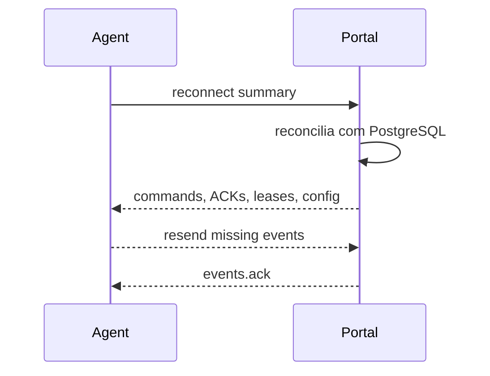

# Reconexao

Status: vigente.

Ao reconectar, o Agent envia resumo local:

```json
{
  "agent_id": "agt_123",
  "agent_instance_id": "agi_456",
  "last_received_command_sequence": 550,
  "pending_event_count": 27,
  "running_attempts": [
    {
      "execution_attempt_id": "att_001",
      "lease_id": "lease_456",
      "last_event_sequence": 180
    }
  ]
}
```

O Portal responde com:

- Comandos nao confirmados.
- Ultimo evento confirmado por tentativa.
- Leases validos.
- Tentativas que devem continuar.
- Tentativas canceladas.
- Configuracao atual.
- Versao desejada.
- Capabilities que precisam ser atualizadas.



O Portal nao confia cegamente no resumo do Agent; ele reconcilia tudo com o
estado persistido.

