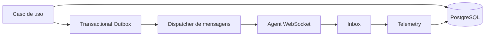
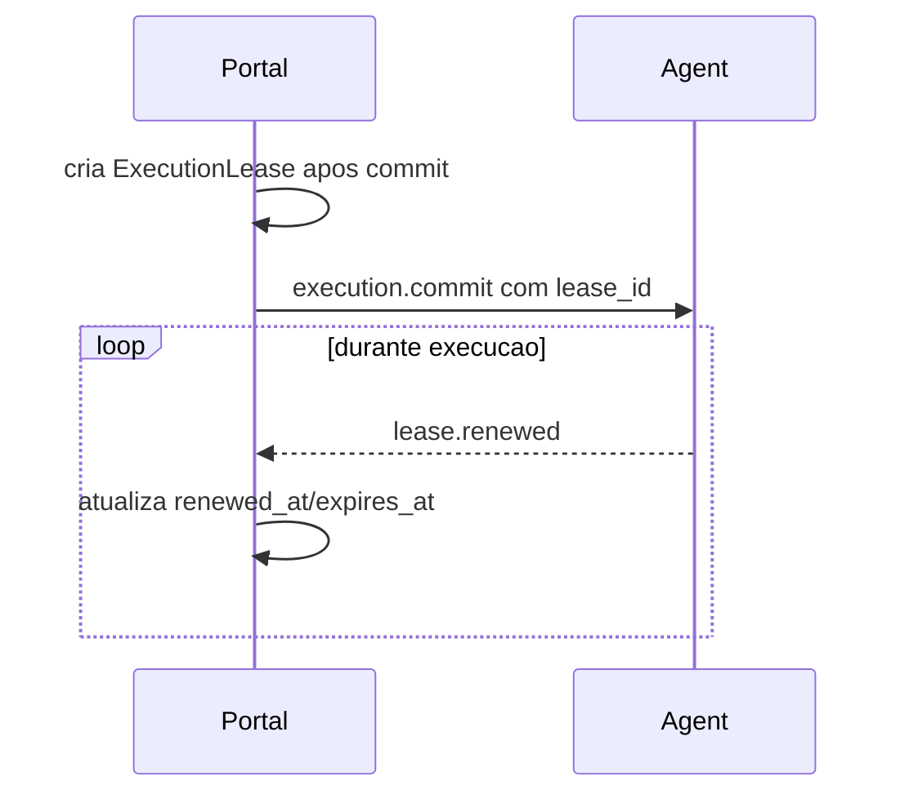

# Confiabilidade

Status: vigente.

## Outbox, inbox e command log

Mensagens recebidas do Agent devem ser deduplicadas por `message_id`.



`AgentCommand` e entidade persistente:

```text
AgentCommand
  id
  agent_id
  agent_instance_id
  command_sequence
  message_type
  payload
  status
  created_at
  sent_at
  acknowledged_at
  expires_at
  attempts
  last_error
```

Estados:

- `pending`
- `sent`
- `acknowledged`
- `expired`
- `failed`
- `cancelled`

## Leases



Se o lease expirar:

1. Marque a tentativa como suspeita.
2. Aguarde periodo de tolerancia.
3. Consulte o Agent quando possivel.
4. Reconcilie estado.
5. Marque `lost` somente quando necessario.
6. Aplique retry conforme politica.
7. Evite duplicidade enquanto houver risco real de execucao ainda viva.

Nao faca retry imediato por perda momentanea de WebSocket.

## WebSocket e HTTPS

WebSocket nao transporta binarios grandes nem grandes spools de eventos.
Downloads, uploads e sincronizacoes extensas usam HTTPS/S3/MinIO.
