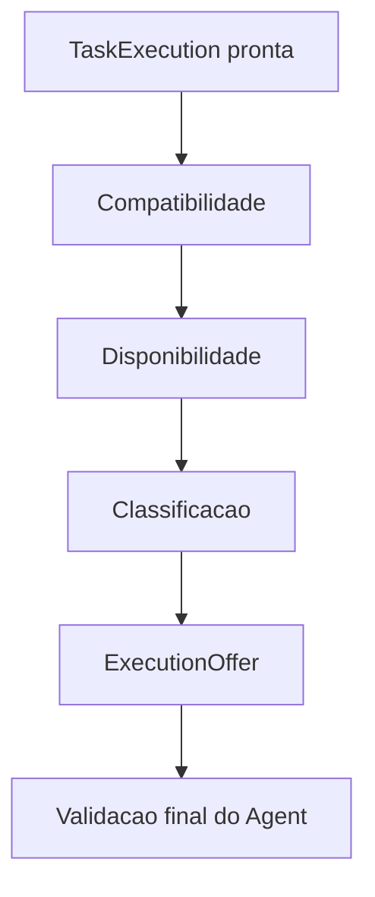

# Scheduler

Status: vigente.

O Scheduler opera em tres fases: compatibilidade, disponibilidade e
classificacao. O resultado deve ser explicavel.

## Compatibilidade

Filtrar por:

- Sistema operacional.
- Arquitetura.
- Versao do protocolo.
- Versao do Agent.
- Capabilities.
- Runtime.
- Tipo de execucao.
- Sessao interativa.

## Disponibilidade

Filtrar por:

- Conectividade.
- Estado administrativo.
- Saude.
- Pools.
- Memoria.
- Disco.
- Reservas.
- Locks.
- Sessao.
- Snapshots recentes.

## Classificacao

Pontuar por:

- Runtime em cache.
- Pacote em cache.
- Baixa carga.
- Memoria disponivel.
- Estabilidade.
- Historico de sucesso.
- Afinidade.
- Grupo.
- Custo de preparacao.
- Prioridade.

Nao selecione apenas o primeiro Agent online, o Agent com menor CPU ou o Agent
com mais slots. Registre fatores usados na pontuacao.

## Recursos exclusivos

Exemplos de locks:

- `agent:{agent_id}:windows_desktop`
- `agent:{agent_id}:dominio_application`
- `agent:{agent_id}:excel_application`
- `client:{client_id}`
- `company:{company_id}`
- `directory:{normalized_path}`
- `credential:{credential_id}`

Portal evita conflitos globais conhecidos. Agent valida recursos locais no
momento da oferta.

