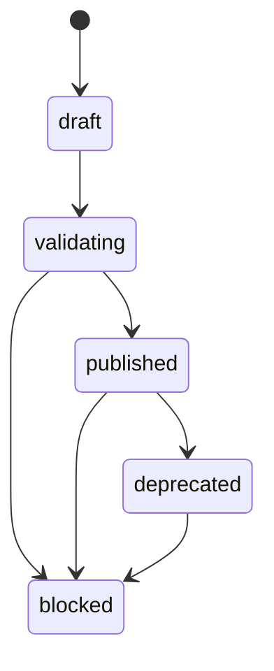
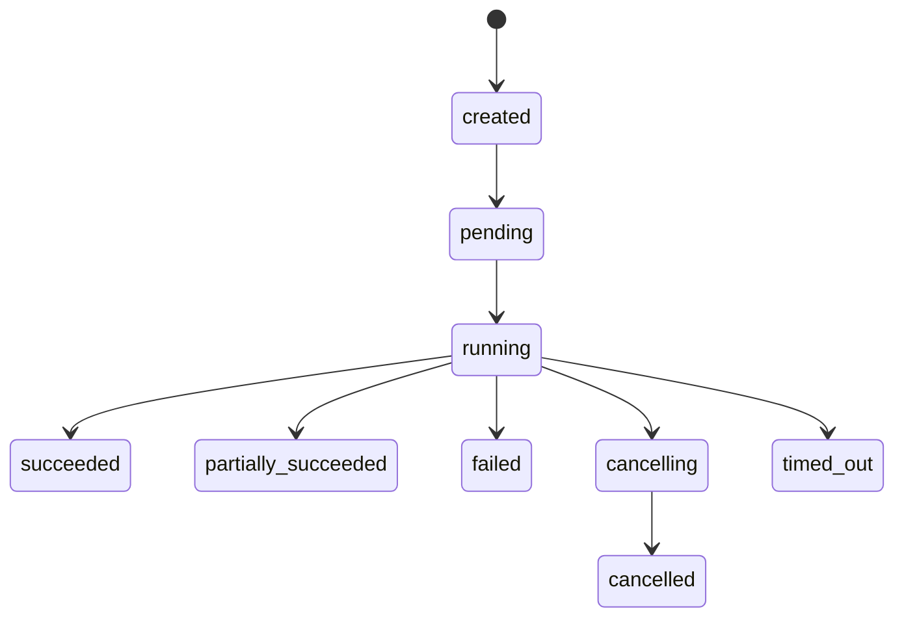
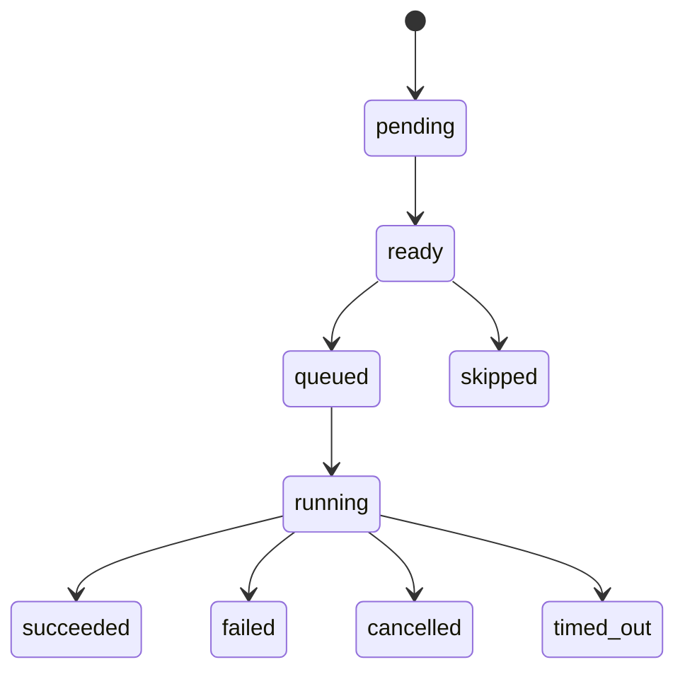
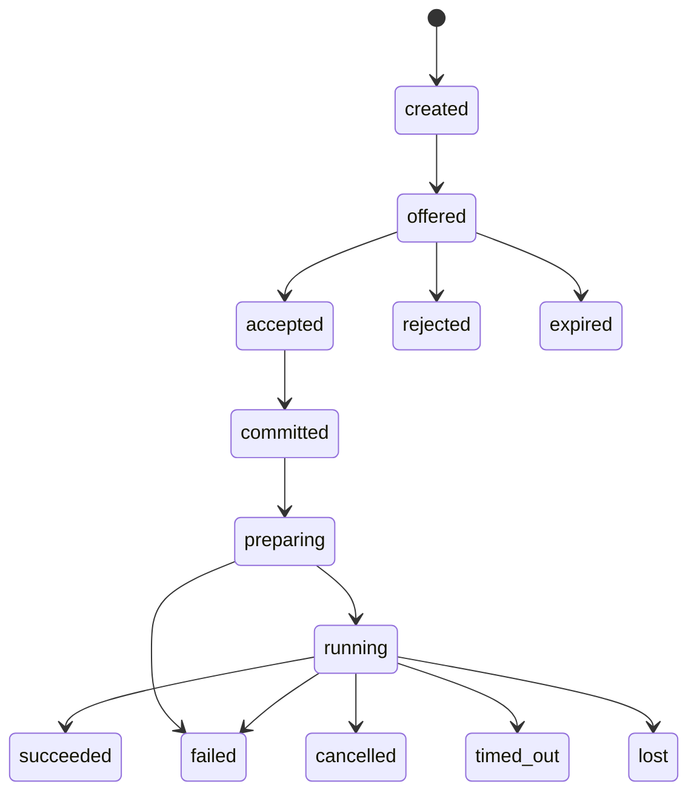
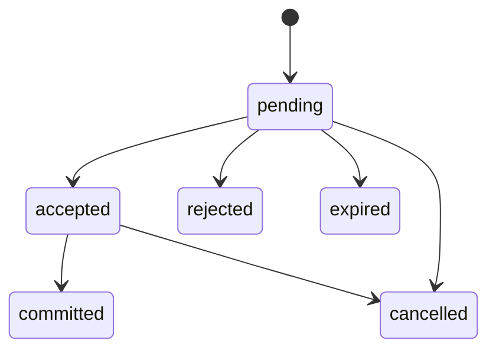
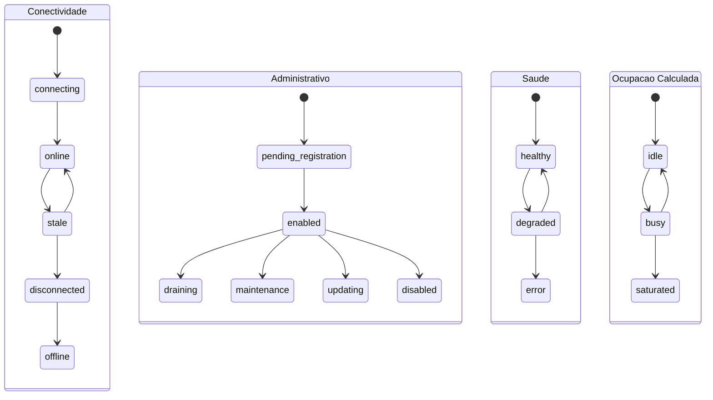

# Maquinas de Estado

Status: vigente.

Estados oficiais tambem estao publicados em `contracts/executions/states.json`.
Transicoes funcionais serao implementadas em etapa posterior; este documento
define os limites.

## AutomationVersion



Estados: `draft`, `validating`, `published`, `deprecated`, `blocked`.

Regras:

- Versao publicada e imutavel.
- Correcao gera nova versao.
- Versao usada por execucao nao pode ser removida.

## Execution



Estados: `created`, `pending`, `running`, `succeeded`,
`partially_succeeded`, `failed`, `cancelling`, `cancelled`, `timed_out`.

## TaskExecution



Estados proibidos em TaskExecution: `offered`, `accepted`, `committed`,
`rejected`, `expired`.

## ExecutionAttempt



Cada retry cria uma nova tentativa. Tentativas anteriores nao sao
sobrescritas.

## ExecutionOffer



Oferta rejeitada nao e falha da automacao.

## Agent

Agent possui estados multidimensionais.



`busy` nao substitui conectividade. Heartbeat nao sobrescreve politica
administrativa.

## Sequencias

Command sequence:

```text
agent_id + command_sequence
```

Event sequence:

```text
execution_attempt_id + event_sequence
```

Nao reutilize uma unica sequencia para comandos e eventos.
